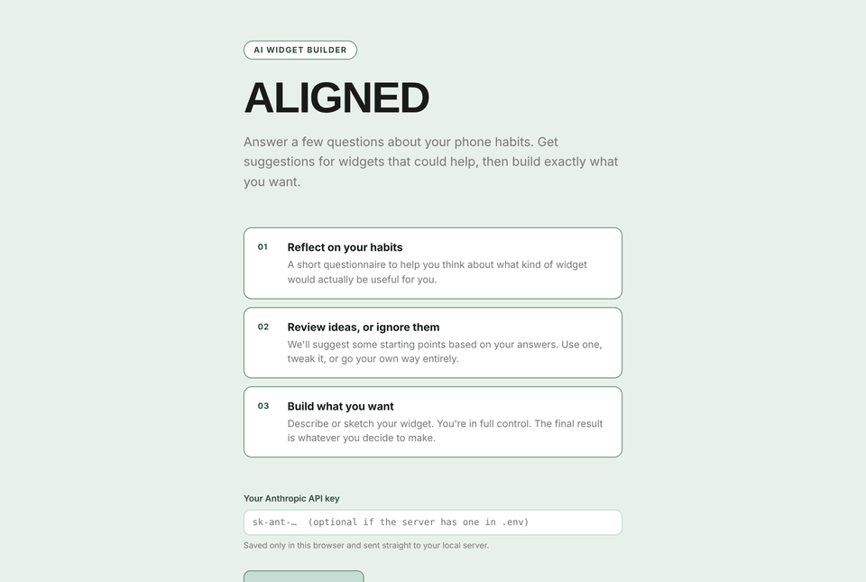
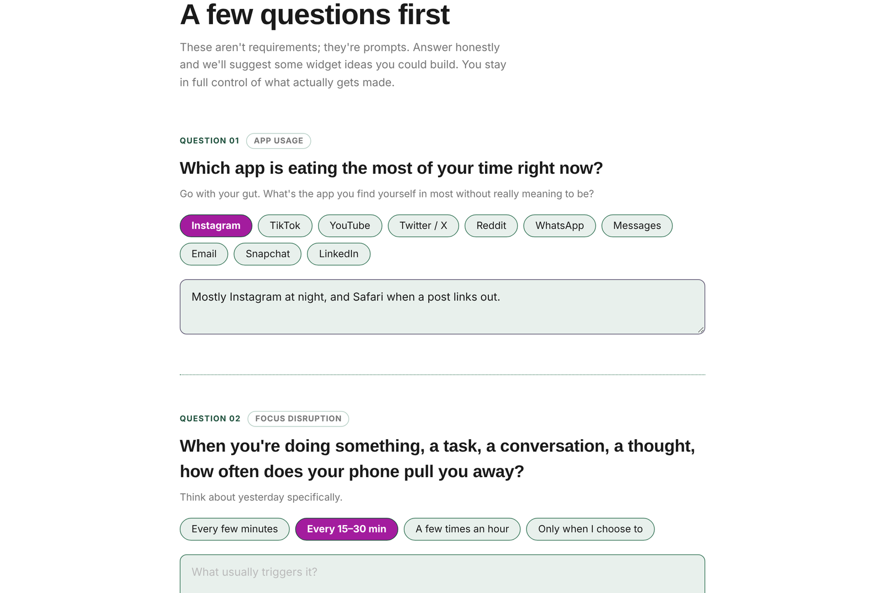
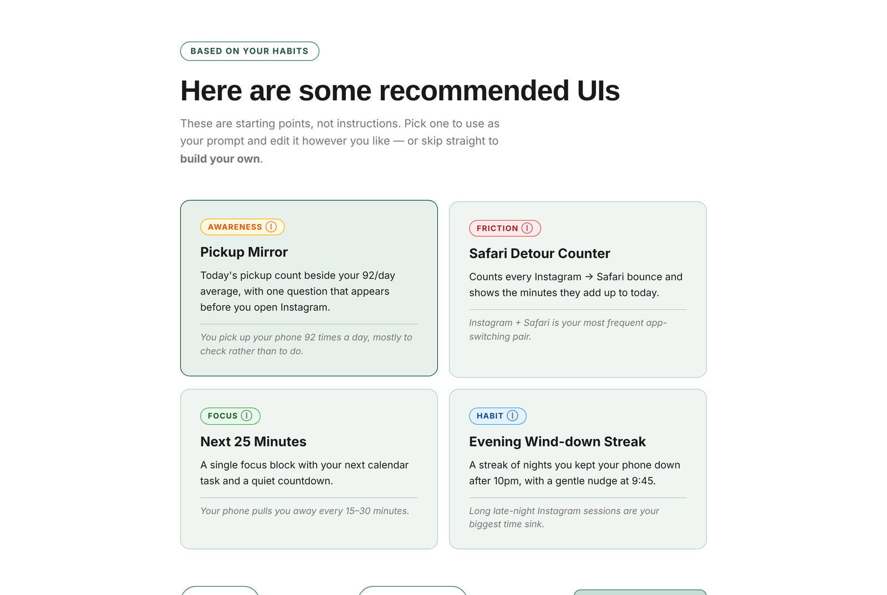
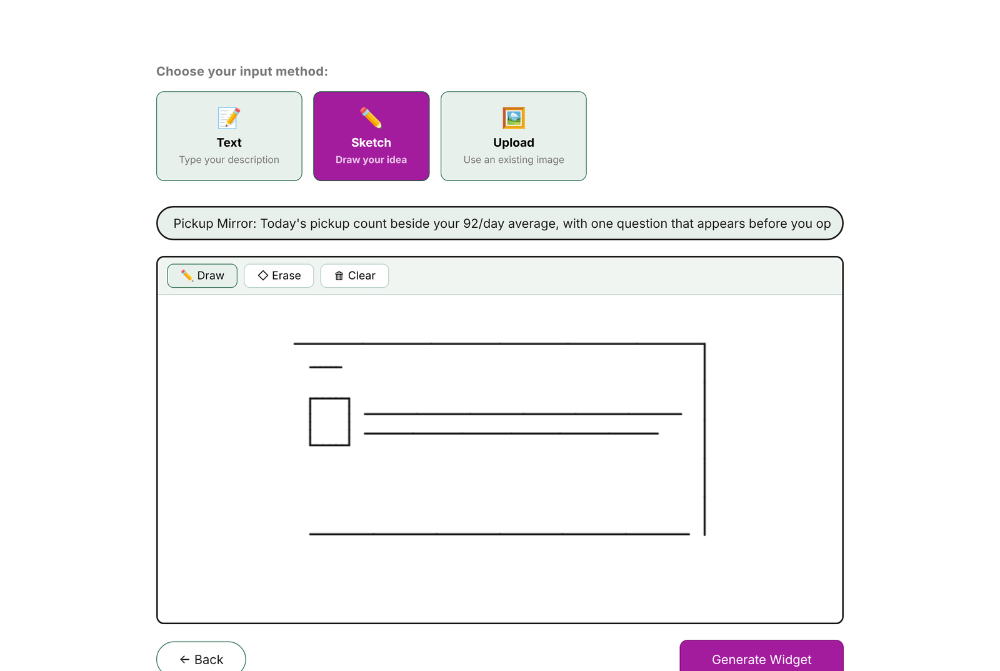
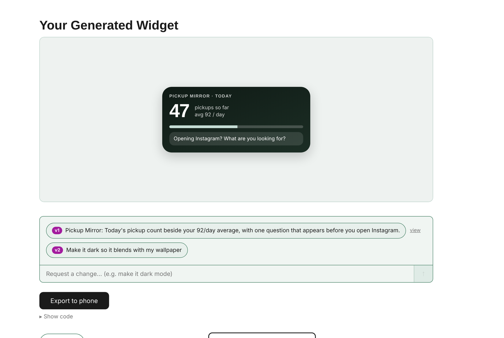

# ALIGNED — Widget Builder

**Phones are built around apps, not around the people using them.** ALIGNED is a framework and working tool that helps people design home-screen widgets around how their day actually goes, not around a template.

> Thesis project · Interaction design + AI prototyping · React, Express, Claude API

<!-- Replace with a hero GIF of the flow: docs/screenshots/hero.gif -->


---

## The problem

The information people need every day is spread across apps that don't talk to each other, so people end up doing the work of connecting it in their heads. Screen time grows, and "checking" turns into a habit.

User research showed that the main frustration is **functional mismatch, not aesthetics**. People don't want prettier widgets. They want interfaces that fit how their lives are actually structured.

## The ALIGNED framework

ALIGNED is a three-stage framework that keeps the user in control from start to finish.

| Stage | What happens | In the tool |
|---|---|---|
| **1. Identify** | The system finds where the phone already creates unnecessary effort, using the user's own Screen Time and app habits, so they don't have to diagnose the problem themselves. | Six reflection questions → AI-suggested widget ideas tagged *Focus*, *Awareness*, *Friction* or *Habit* |
| **2. Collaborate** | The user works with an AI agent in whatever way feels natural (a description, a sketch, an idea to riff on) to create an interface built around their habits. | Text or canvas-sketch input → Claude generates the widget → chat-style refinement with version history |
| **3. Implement** | The user decides whether it goes on their phone. Nothing is added without a deliberate choice. | One-tap export to the iOS home screen through Scriptable |

Over time, what a user builds is saved and maintained, so the work isn't lost when their habits change.

## How it works

```
 Reflect (6 Qs)  ──►  Ideas (AI)  ──►  Properties  ──►  Describe / Sketch  ──►  Generate  ──►  Refine  ──►  Export to phone
      │                   │                                    │                    │            │
  Screen Time        /api/ideas                         canvas → PNG          /api/generate  /api/refine
  habits feed        returns 4 JSON                     sent as vision        HTML widget    edits the
  every prompt       ideas + rationale                  input to Claude       in sandbox     current HTML
```

- **Personalised prompts:** answers from the reflection step go into every generation call, so widgets respond to the user's real habits (most-used apps, pickups, app-switching pairs).
- **Multimodal input:** sketches drawn on an HTML canvas are sent to Claude as images next to the text spec.
- **Iteration without losing work:** every refinement is a new version, and earlier versions can be reopened from the chat history.
- **Safe preview:** generated HTML renders in a sandboxed `<iframe>`.

## Screenshots

<!-- Drop images into docs/screenshots/ with these names -->
| Reflect | Ideas | Sketch | Result |
|---|---|---|---|
|  |  |  |  |

## Tech stack

- **Frontend:** React 18 + Vite 5
- **Backend:** Express (Node.js), a thin proxy to the Claude API
- **AI:** Anthropic Claude (`claude-sonnet-4-6` by default, configurable), with vision input for sketches

## Run it locally

**Prerequisites:** Node.js 18+ and an [Anthropic API key](https://console.anthropic.com/).

```bash
npm install
npm run dev          # starts Vite (5173) and the API server (3001)
```

Open `http://localhost:5173`. You can provide an API key in either of two ways:

- **Paste it on the Home screen.** It's kept in your browser's local storage and sent only to your local server, or
- **Put it in `.env`:** `cp .env.example .env`, then set `ANTHROPIC_API_KEY`.

Optional: set `ANTHROPIC_MODEL` in `.env` to use a different Claude model.

## Project structure

```
├── server/
│   └── index.js               # Express API: /api/ideas, /api/generate, /api/refine
├── src/
│   ├── App.jsx                # Screen routing + shared state
│   ├── api.js                 # fetch helper + bring-your-own-key storage
│   ├── index.css              # All styles
│   └── components/
│       ├── Home.jsx
│       ├── StepReflect.jsx    # Identify: 6 habit questions across 2 pages
│       ├── StepIdeas.jsx      # Identify: AI-suggested widget ideas
│       ├── Step1Properties.jsx
│       ├── Step2Describe.jsx  # Collaborate: text + canvas sketch input
│       ├── Step3Loading.jsx
│       └── Step4Result.jsx    # Collaborate + Implement: preview, refine, export
└── docs/
    ├── screenshots/
    └── archive/
        └── thesis-prototype-v1.html   # First single-file prototype, kept for process
```

## What I'd do next

- **Real Screen Time data:** replace self-reported answers with the iOS DeviceActivity API, so the *Identify* step needs no manual input.
- **Zero-copy install:** a one-time Scriptable loader that fetches widgets by a short code, so new widgets and refinements show up on the home screen automatically. A mock of this flow is in the case study.
- **Native widgets:** generate WidgetKit/SwiftUI instead of HTML snapshots, so widgets can be interactive.

## License

[MIT](LICENSE)
